# Architecture of mwaeckerlin/opencode

| Entry | Value |
| --- | --- |
| Reader | Administrators who run the two images, developers who change them |
| Subject | The images `mwaeckerlin/opencode:sandbox` and `mwaeckerlin/opencode:gateway`, their sample stack and their build |
| Basis | [FEATURES.md](FEATURES.md), [TESTS.md](TESTS.md), `Dockerfile.sandbox`, `Dockerfile.gateway`, `docker-compose.yml`, `gateway/gateway.mjs`, `base-path/`, `plugin/` |
| Date | 2026-11-01 |

The structure follows [arc42](https://arc42.org/). Every external product is named by its function and mapped to its supplier in section 12.2.

## 1. Introduction and Goals

### 1.1 Requirements Overview

The project runs the [coding agent](#coding-agent) as a server with its web interface, split into a [sandbox](#sandbox) that holds no key and a [gateway](#gateway) that holds the keys. The user story:

1. The administrator gives the gateway the key of the [LLM proxy](#llm-proxy) and the key of the [memory service](#memory-service) as secrets of the [container orchestrator](#container-orchestrator) (F5, F12).
2. He names the models in `OPENCODE_MODELS` and, where the interface lies below a path of a shared address, the path in `OPENCODE_BASE_PATH` (F2, F13).
3. The developer opens port 4096, enters the server password where one is set, and works with the agent in `/workspace` (F1, F11).
4. Every model call and every memory call of the agent leaves the sandbox through the gateway, which adds the key (F2, F3, F5, F6).
5. Other agents of the stack hand tasks to the same server through its API (F10).
6. Where models run on a subscription of the [LLM proxy](#llm-proxy), the administrator names its login page; the web interface links to it, and a failed answer of a subscription model posts the link into its session (F15, F17).
7. The [alerting service](#alerting-service) posts its alerts with a token into the alert session, where the developer reads them in the web interface (F16).

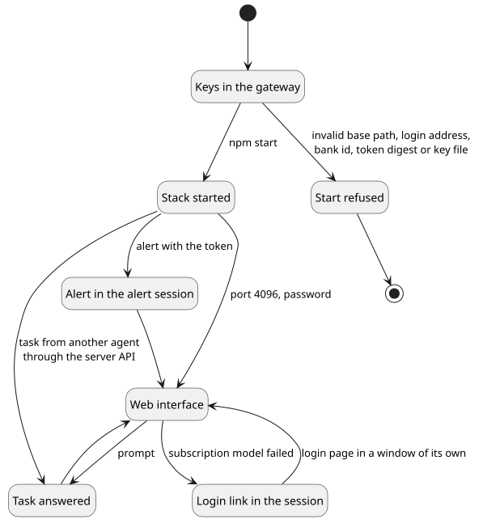

PlantUML source

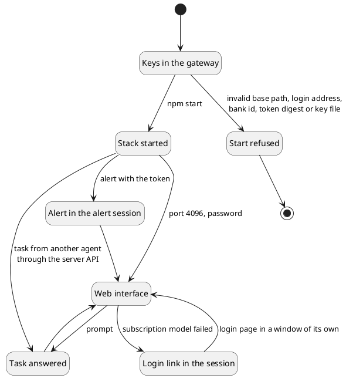

### 1.2 Quality Goals

| # | Goal | Measured by |
| --- | --- | --- |
| 1 | No key reaches the sandbox | the end-to-end test searches environment, configuration and files of the sandbox (F4) |
| 2 | The sandbox reaches its gateway and nothing else | the internal network and the paths the gateway refuses (F6) |
| 3 | The web interface works below any path of a shared address | the browser suite below `/opencode` (F13) |
| 4 | The gateway carries no shell | the image contract (F8) |
| 5 | No secret of the alerting reaches the sandbox | the sandbox holds the digest of the alert token alone (F16) |

### 1.3 Stakeholders

| Who | Expects |
| --- | --- |
| Administrator | keys that stay in one container, every setting an environment variable |
| Developer | the agent in the browser, with its tools in the sandbox |
| Other agents of the stack | one central server that takes tasks over its API |
| [Alerting service](#alerting-service) | one address with a token for its alerts |
| Maintainer | a build that stops when a release of the [coding agent](#coding-agent) changes what the front process adjusts |

## 2. Architecture Constraints

| Constraint | Consequence |
| --- | --- |
| The [coding agent](#coding-agent) runs its tools in the process that talks to the model | the process and its tools stay in the [sandbox](#sandbox), which therefore holds no key and is not [headless](#headless) |
| Images of the family come from `mwaeckerlin/…` | sandbox on `mwaeckerlin/sandbox-base`, gateway on `mwaeckerlin/nodejs` |
| The [coding agent](#coding-agent) ships as one compiled executable without a setting for a base path | a [front process](#front-process) serves it below the path |
| Images are built and published by the [shared workflow](#shared-workflow) | the caller sets `free-disk: true`, which removes the preinstalled SDKs of the runner before the build |

## 3. Context and Scope

### 3.1 Business Context

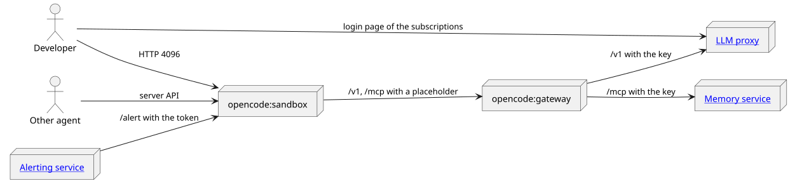

PlantUML source

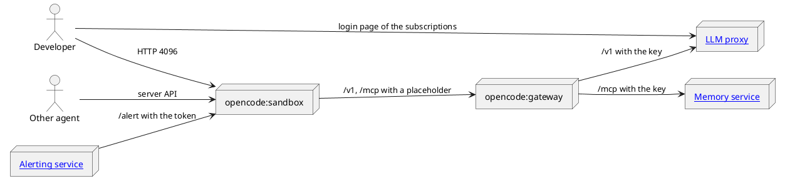

| Partner | Exchanged |
| --- | --- |
| Developer | web interface, terminal, live updates; the link to the login page of the subscriptions of the [LLM proxy](#llm-proxy) |
| Other agent | sessions and messages over the server API, or `opencode run --attach` |
| [Alerting service](#alerting-service) | webhooks with the alert token below `/alert` |
| [LLM proxy](#llm-proxy) | model calls `/v1/…`, streamed answers |
| [Memory service](#memory-service) | the MCP servers `hindsight-shared` and `hindsight-own` below `/mcp/…` |

### 3.2 Technical Context

| Interface | Protocol | Default |
| --- | --- | --- |
| Web interface and server API | HTTP, websockets, event stream | port 4096, `OPENCODE_PORT` |
| Alert relay | HTTP `POST` or `PUT`, `Authorization: Bearer` | `/alert` on port 4096, `OPENCODE_ALERT_TOKEN_SHA256` |
| [Coding agent](#coding-agent) behind the [front process](#front-process) | HTTP | `127.0.0.1:14096` |
| Gateway | HTTP | port 8080, `OPENCODE_GATEWAY_PORT` |
| Upstreams of the gateway | HTTP or HTTPS | `LITELLM_URL`, `HINDSIGHT_URL` |

## 4. Solution Strategy

| Goal | Answer |
| --- | --- |
| No key in the sandbox | the [coding agent](#coding-agent) sends a placeholder; the gateway replaces the Authorization header with the key read from a secret file |
| One way out | the network `sandbox` is internal and holds the two containers alone; the gateway forwards `/v1/…` and `/mcp/…` and answers every other path with 404 |
| Interface below a path | the [front process](#front-process) takes the path off every request and puts it in front of every root-absolute address of the page, the bundle and the redirects |
| A release that changes the interface | `base-path/patch-upstream.mjs verify` stops the image build with file and text |
| Login link in an interface without a plugin point | the [front process](#front-process) writes the link as markup in a bar above the interface, with a stylesheet of the origin and no script |
| Alerts from a sender that cannot open a session | the [alert relay](#alert-relay) keeps one [alert session](#alert-session) and posts into it with `noReply` |
| Login link in the chat | the [plugin](#plugin) posts it on `session.error` of a [subscription model](#subscription-model) |

## 5. Building Block View

### 5.1 Whitebox Overall System

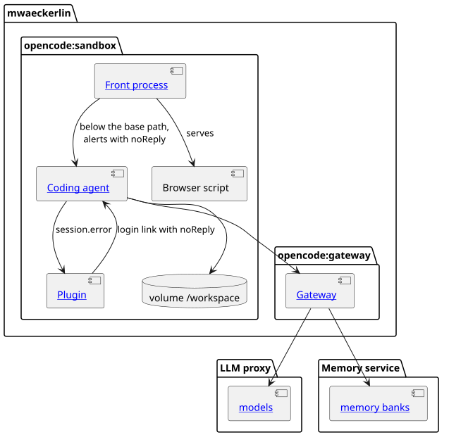

PlantUML source

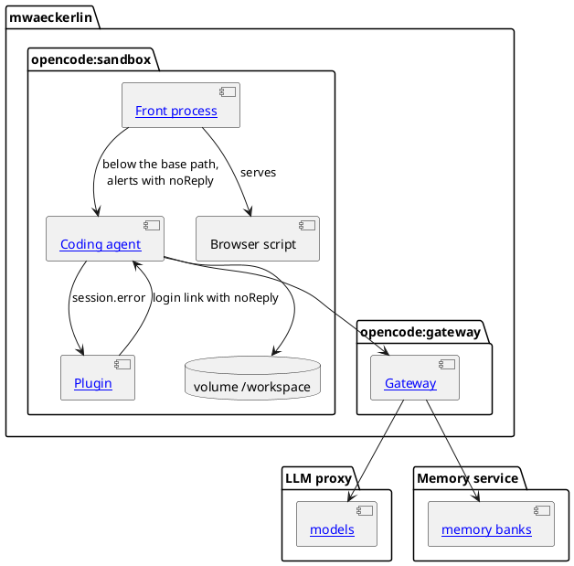

| Block | Responsibility |
| --- | --- |
| [Front process](#front-process), `base-path/serve.mjs` and `base-path/configuration.mjs` | starts the agent on the loopback interface and serves it below `OPENCODE_BASE_PATH`, writes the login link into the page, and carries the [alert relay](#alert-relay); active only when `OPENCODE_BASE_PATH`, `LITELLM_SUBSCRIPTION_LOGIN_URL` or `OPENCODE_ALERT_TOKEN_SHA256` is set |
| Login link stylesheet, `base-path/opencode-login-link.css` | sets the bar of the link above the interface and shortens the interface by its height, in the tokens of the interface |
| [Plugin](#plugin), `plugin/subscription-login.js` | posts the login link into a session whose [subscription model](#subscription-model) failed |
| Browser script, `base-path/opencode-base-path.js` | puts the base path in front of every root-absolute request of the bundle |
| Router patch, `base-path/patch-upstream.mjs` | gives the router of the interface the base path, and checks at build time that the code is still there exactly once |
| [Coding agent](#coding-agent) | the agent, its tools and its web interface; configuration from the environment through `mwaeckerlin/sandbox-base` |
| [Gateway](#gateway), `gateway/gateway.mjs` | the only holder of keys; forwards two routes and streams the answers |

## 6. Runtime View

### 6.1 A Model Call

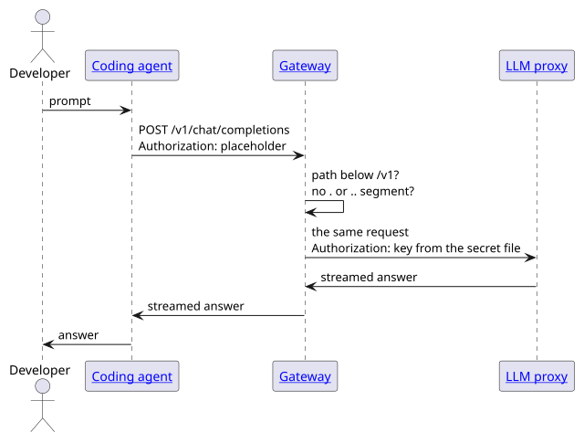

PlantUML source

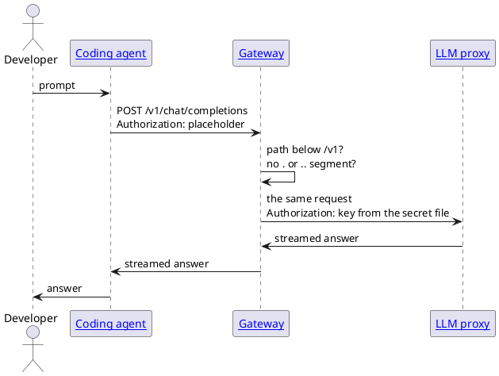

### 6.2 A Request Below the Base Path

The browser asks for `/opencode/session`. The [front process](#front-process) removes `/opencode`, asks the agent for `/session` in plain text, and puts `/opencode` in front of every root-absolute `Location` of the answer. The bare path `/opencode` answers 308 to `/opencode/`. A request outside the base path reaches the agent unchanged, for the health check and the agents of the stack.

### 6.3 An Alert

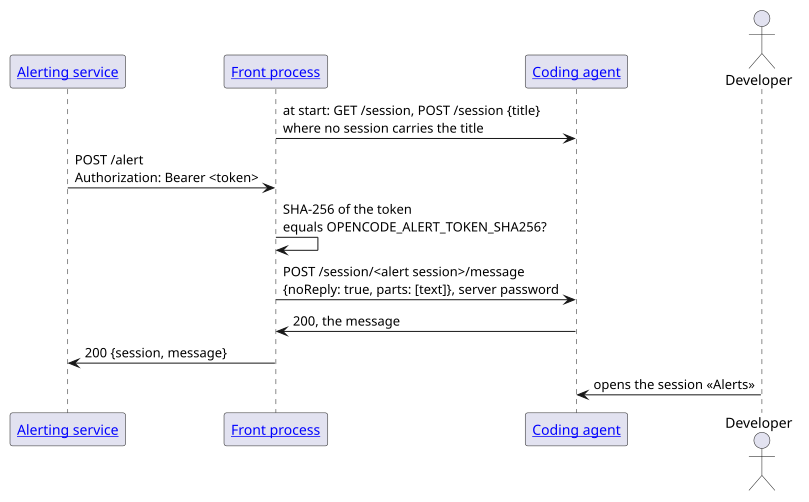

PlantUML source

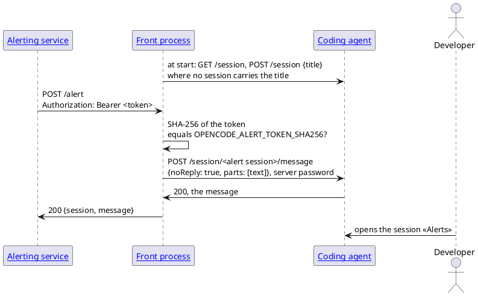

A token whose digest differs, or none, answers 401 before the body is read. Where the agent answers 404 for the [alert session](#alert-session), because it was deleted, the front process finds or creates it once more and posts again.

### 6.4 A Failed Subscription Model

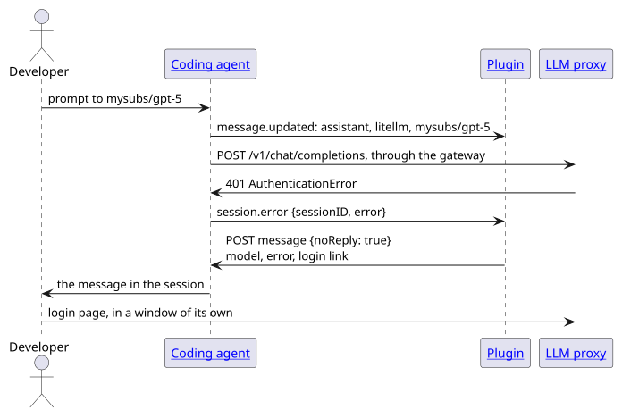

PlantUML source

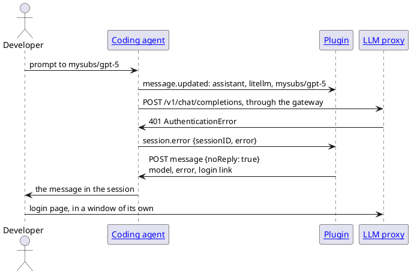

A retryable answer, such as 500, the agent repeats five times before `session.error` follows; the measurement in the image took 73 seconds.

## 7. Deployment View

### 7.1 Sample Stack

| Service | Networks | Published |
| --- | --- | --- |
| `opencode-sandbox` | `sandbox` (internal) | port 4096 on every address of the host, or on `BIND_ADDRESS` where it names one |
| `opencode-gateway` | `sandbox`, `services` | nothing |

The [LLM proxy](#llm-proxy) and the [memory service](#memory-service) join the network `services` from stacks of their own. Behind a [reverse proxy](#reverse-proxy) the sandbox also joins the network of the proxy, as the example in the README shows. The [alerting service](#alerting-service) reaches `/alert` over a network it shares with the sandbox, or through the reverse proxy below the base path; the sample stack carries neither.

### 7.2 Build and Publishing

The [shared workflow](#shared-workflow) builds both images on every push to `master`, on a schedule when a parent image changed, and once a week, runs `npm test` per architecture, and publishes `sandbox`, `gateway` and their dated and versioned tags to the [image registry](#image-registry).

## 8. Cross-cutting Concepts

### 8.1 Security

- Keys exist only as secret files of the gateway; an empty or missing key file stops the start, a missing variable forwards the route without a key.
- The server password is optional; without it whoever reaches port 4096 controls the agent. The sample stack publishes the port on every address of the host unless `BIND_ADDRESS` names one, so a stack without a password sets `BIND_ADDRESS=127.0.0.1` to keep the agent on the local machine.
- The gateway can pass on only the keys it holds; a scoped key of the [LLM proxy](#llm-proxy) limits what the agent can spend.
- The [alerting service](#alerting-service) holds the alert token, the sandbox its SHA-256 digest; the relay compares the digests in constant time and refuses the server password, which would give the sender the whole agent.
- The login link is markup with a stylesheet of the origin; the content security policy of the [coding agent](#coding-agent) stays as it is, and the page gets no script for the link.

### 8.2 Configuration

Every setting is an environment variable with a default, listed in the README; the keys and the server password are files named by `*_FILE` variables.

### 8.3 Tests

`npm test` runs the docs contract, the compose contract, the unit tests of the gateway and of the front process against real HTTP servers, the image contract of the gateway, and the end-to-end suite with a real [LLM proxy](#llm-proxy) in front of a simulated model provider, the image `mwaeckerlin/hindsight`, a real [alerting service](#alerting-service) and a browser below `/opencode` behind a [reverse proxy](#reverse-proxy); [TESTS.md](TESTS.md) maps every test to its feature.

## 9. Architecture Decisions

| # | Decision | Reason | Cost |
| --- | --- | --- | --- |
| 9.1 | Two images, the keys in the gateway | the agent runs arbitrary tools and must not be able to read a key | one more container, one more network |
| 9.2 | The base path in a front process of the sandbox | the reverse proxy needs no StripPrefix and no rewriting of pages | a patch of the router that is checked on every build |
| 9.3 | The build fails when the interface changed | a silent break of the base path would only show in the browser | a release of the agent can stop the build until the patch follows |
| 9.4 | Published port on every address unless `BIND_ADDRESS` names one | earlier versions published it on every address, and a stack that sets nothing stays reachable | without a server password and without `BIND_ADDRESS` the web interface is open to the network |
| 9.5 | An alert token of its own, held by the sender, its digest in the sandbox | the token allows one message into one session; the server password would allow the sender the whole agent, and a token file in the sandbox would put a secret where none belongs | the administrator computes the digest once |
| 9.6 | The login link as markup in a bar above the interface | the interface has no plugin point, and the security policy allows scripts of the origin only; markup needs no script at all, and a bar of its own covers no tab, which a link laid over the window does on a phone | the interface loses 1.75rem of height |
| 9.7 | A subscription model recognised by its name | the error text of a failed subscription depends on the subscription and its provider; the model name is set by the administrator of the [LLM proxy](#llm-proxy) | every failure of such a model posts the link, also one that a new login does not cure |

## 10. Quality Requirements

### 10.1 Quality Scenarios

| # | Stimulus | Expected reaction | Test |
| --- | --- | --- | --- |
| 10.1.1 | a search for both keys in the sandbox | neither key in environment, configuration or file | `no_litellm_key_in_sandbox`, `no_hindsight_key_in_sandbox` |
| 10.1.2 | the sandbox calls the [LLM proxy](#llm-proxy) directly | not reachable | `sandbox_cannot_reach_litellm` |
| 10.1.3 | a path with a `..` segment at the gateway | 404 | `gateway/gateway.test.mjs` |
| 10.1.4 | the interface below `/opencode` in a browser | every request stays below the path | `test_page_renders_and_every_request_stays_below_the_base_path` |
| 10.1.5 | an alert without the token, with another token or with the server password | 401, nothing in the alert session | `alert_refused_without_token`, `alert_refused_with_a_wrong_token`, `alert_refused_with_the_server_password` |
| 10.1.6 | a subscription model gets an AuthenticationError | the login link in its session, no answer of the model | `failed_subscription_model_gets_the_login_link` |
| 10.1.7 | the login link in Chromium and Firefox, on a phone, in a session and below `/opencode` | visible, inside the window, over no control of the interface, the interface down to the bottom edge, address unchanged | `test_login_link.py` |

## 11. Risks and Technical Debt

### 11.1 Risks

| Risk | Effect | What reduces it |
| --- | --- | --- |
| A new release of the [coding agent](#coding-agent) changes its router or page | the base path breaks | the build check stops the build with file and text |
| Whoever controls the agent uses the keys within their limits | model and memory calls on the account of the operator | scoped keys; the split hides the keys and does not limit their use |
| A new release of the [coding agent](#coding-agent) changes `session.error`, the plugin directory or the layout of its window | no login link in the chat, or a link over a control of the interface | the end-to-end test of the plugin and the browser test of the link fail |

### 11.2 Technical Debt

- The sandbox is not [headless](#headless) by design; the decision is recorded in `~/git/mwaeckerlin/TODO.md`.

## 12. Glossary

### 12.1 Terms

| Term | Meaning |
| --- | --- |
| Sandbox | the image `mwaeckerlin/opencode:sandbox`, which runs the agent and its tools and holds no key |
| Gateway | the image `mwaeckerlin/opencode:gateway`, the only container with keys |
| Front process | `base-path/serve.mjs`, which serves the agent below `OPENCODE_BASE_PATH` |
| Headless | an image without a shell, without busybox and without perl |
| Alert relay | the path `/alert` of the [front process](#front-process), which takes a webhook with the alert token into the [alert session](#alert-session) |
| Alert session | the session of the [coding agent](#coding-agent) titled `OPENCODE_ALERT_SESSION_TITLE`, «Alerts» by default |
| Plugin | `plugin/subscription-login.js`, which the [coding agent](#coding-agent) loads from `OPENCODE_CONFIG_DIR` |
| Subscription model | a model of the provider `litellm` whose name starts with `LITELLM_SUBSCRIPTION_MODEL_PREFIX`, `mysubs/` by default |
| Shared workflow | `mwaeckerlin/scratch/.github/workflows/docker-image.yml`, called by `.github/workflows/docker.yml`, running on the [CI service](#ci-service) |

### 12.2 Logical Designations

<table>
<thead><tr><th>Logical designation</th><th>Description</th><th>Company in the UK</th><th>Company in Switzerland</th></tr></thead>
<tbody>
<tr><td>Coding agent</td><td>OpenCode, the agent with its web interface and server API</td><td colspan="2">Anomaly Innovations, Inc.</td></tr>
<tr><td>LLM proxy</td><td>LiteLLM, which offers the models behind <code>/v1</code> and, with the plugin litellm-mysubs, the login page of the subscriptions</td><td colspan="2">BerriAI, Inc.</td></tr>
<tr><td>Alerting service</td><td>Grafana or Alertmanager, which send alerts as webhooks</td><td colspan="2">Grafana Labs; Alertmanager of the Prometheus project, Cloud Native Computing Foundation</td></tr>
<tr><td>Memory service</td><td>Hindsight, run as <code>mwaeckerlin/hindsight</code>, with one MCP endpoint per memory bank</td><td colspan="2">Vectorize, Inc.</td></tr>
<tr><td>Reverse proxy</td><td>Traefik, in the example of the README and in the browser suite</td><td colspan="2">Traefik Labs</td></tr>
<tr><td>Container orchestrator</td><td>Docker Swarm or Docker Compose, which hand the secrets to the gateway</td><td colspan="2">Docker, Inc.</td></tr>
<tr><td>Image registry</td><td>Docker Hub, where the images are published</td><td colspan="2">Docker, Inc.</td></tr>
<tr><td>CI service</td><td>GitHub Actions, which runs the shared workflow</td><td colspan="2">GitHub, Inc.</td></tr>
</tbody>
</table>
